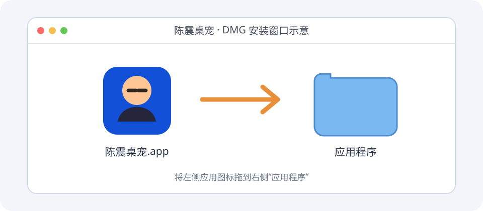
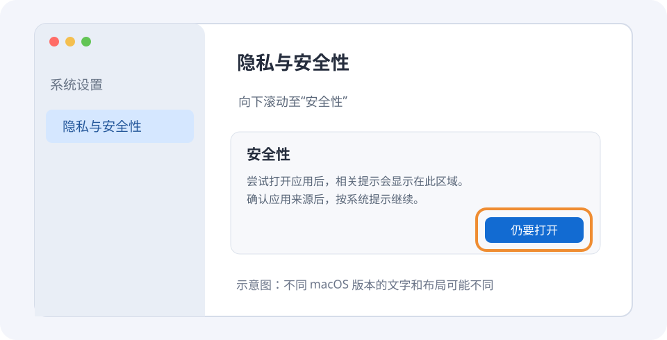

# macOS 安装教程

本教程适用于 macOS 14 或更新版本的 Apple Silicon Mac。当前应用采用本地签名，尚未通过 Apple 公证，第一次从 GitHub 下载并打开时，macOS 可能阻止启动。下面的画面是操作示意图，不同系统版本的布局和提示文字可能不同。

## 1. 下载并安装

1. 打开 [最新发布页面](https://github.com/aaba9152/chenzhen-desktop-pet/releases/latest)，下载 `ChenzhenPet-1.3.4.dmg`。
2. 双击下载的 DMG。在打开的安装窗口里，将“陈震桌宠”图标拖到“应用程序”。
3. 在访达的“应用程序”中打开“陈震桌宠”。

## 2. 系统阻止打开时

如果系统提示无法确认开发者或无法检查应用，且你确认下载的是本项目提供的安装包，可以按下列步骤为该应用单独允许打开：

1. 先尝试打开一次应用并关闭提示框。
2. 打开 **系统设置 → 隐私与安全性**，向下滚动到“安全性”。
3. 找到与“陈震桌宠”相关的提示，点击 **仍要打开**，按系统提示使用密码或触控 ID 确认；如果再次询问，确认打开。
4. 返回“应用程序”，打开“陈震桌宠”。它没有 Dock 图标，会出现在桌面，菜单栏也有“陈震”入口。

“仍要打开”通常只在尝试打开后的一段时间内显示；找不到时可重新尝试打开应用，再回到该页面查看。重新下载或更新版本后，可能需要再次确认。如果系统提示应用已损坏、包含恶意软件或来自不可信来源，请不要继续打开，先核对下载来源并查看 [Apple 官方说明](https://support.apple.com/zh-cn/102445)。

## 3. 验证下载文件（可选）

发布页面的 `SHA256SUMS-1.3.4.txt` 包含安装包的 SHA-256 校验值。打开“终端”，输入 `shasum -a 256 `（末尾留一个空格），将下载的 DMG 拖进终端窗口，再按回车；将输出的校验值与清单中的 DMG 对应值比较，一致后再打开。

## 4. 更新或退出

更新时先从菜单栏“陈震”菜单选择“退出桌宠”，再按第 1 步将新版本拖入“应用程序”，按访达提示替换。应用的大小、音量、位置和选中的人像会保存在本机。

退出时，可右键点击人物选择“退出桌宠”，或从菜单栏“陈震”菜单退出。
